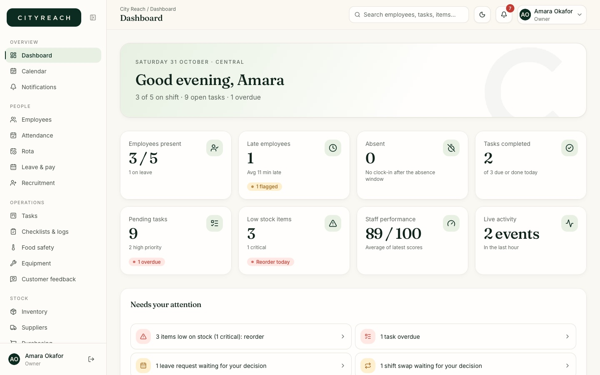
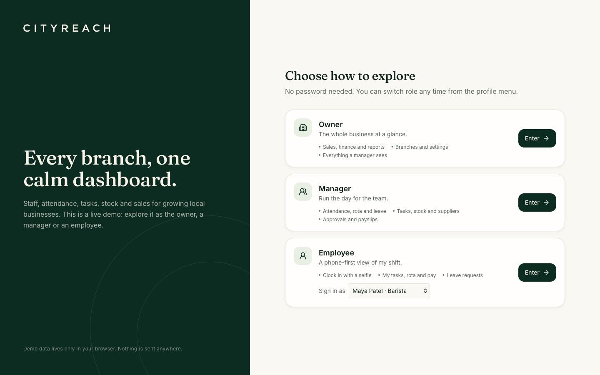
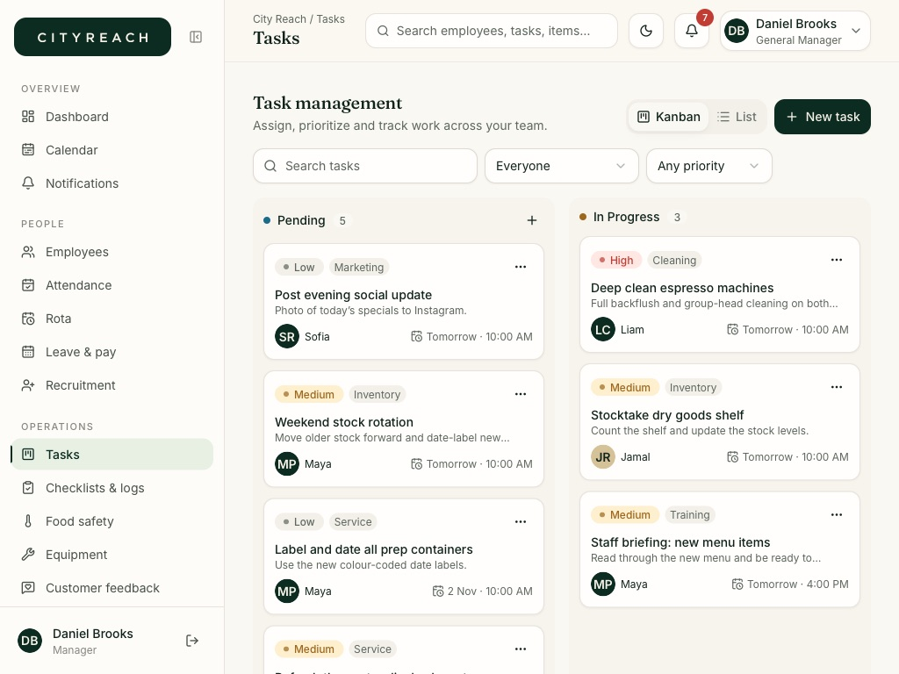
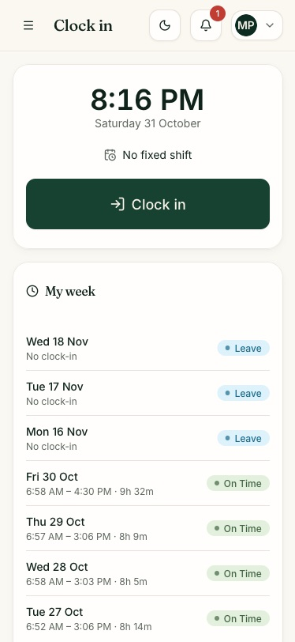

# City Reach

Staff, attendance, tasks, stock and sales for growing local businesses: one calm dashboard for
every branch. This repository is a **self-contained demo**. It has no backend and no secrets; all
data lives in your browser.

**Live demo:** https://cityreach-dashboard.vercel.app



## What you can do

Pick a role on the landing screen (no password) and explore:



- **Owner**: everything a manager sees, plus branches, sales & finance and reports.
- **Manager**: dashboard, attendance, rota, leave & pay, tasks board, stock, suppliers, purchasing,
  food safety, equipment, documents, customer feedback, performance reports (PDF / CSV).
- **Employee** (phone-first): clock in with a selfie and location, my tasks, rota, attendance,
  payslips, leave requests, training & goals.

Writes really work: clock in, create and move tasks, receive stock, approve leave, add sales, and
so on. Changes are saved to `localStorage`. **Settings -> Reset demo data** restores the
original sample business (it also refreshes itself daily so the dates always look current).

| Manager, tablet                            | Employee, phone                                            |
| ------------------------------------------ | ---------------------------------------------------------- |
|  |  |

## Run it

```bash
pnpm install
pnpm dev        # http://localhost:5173
pnpm check      # format, lint, typecheck, tests
pnpm build      # static build in apps/web/dist
```

Node 22+ and pnpm.

## How it is built

React 19, Vite, TypeScript, Tailwind CSS 4, shadcn/ui primitives, TanStack Query, React Hook Form

- Zod, Recharts, jsPDF. pnpm monorepo:

```
apps/web/          the app (UI -> queries -> api -> local store)
packages/shared/   zod schemas, types and the business rules (unit-tested)
```

The feature `api.ts` files talk to an in-memory document store persisted to `localStorage`
(`apps/web/src/lib/store`), seeded with a realistic business (staff, a week and more of
attendance, tasks, stock, suppliers, purchase orders, sales, expenses, payslips, feedback,
documents, rota). The camera, GPS and file upload are believable local mocks. See
[docs/ARCHITECTURE.md](docs/ARCHITECTURE.md), [docs/DATA_MODEL.md](docs/DATA_MODEL.md) and
[docs/FEATURES.md](docs/FEATURES.md).

## Design

The brand colours come from the logo: deep forest green `#0c2c21` and warm white `#f8f3e9`.
All colours are tokens in `apps/web/src/index.css` (light and dark theme); type is Inter with
Fraunces for headings. The wordmark is traced from the supplied artwork.
