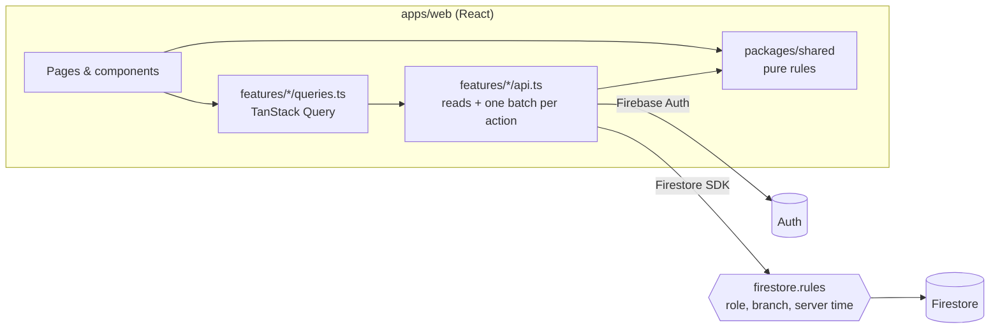

# Architecture

A modular monolith in TypeScript that runs entirely on Firebase's **free (Spark) plan**: one React web app, one shared package for business rules, Firebase for auth and the database, and Vercel serving the built website on `managr.me`. There is **no server code** (no Cloud Functions): the browser does the work and `firestore.rules` is the server-side guard.

## Why no server code

Cloud Functions require the paid Blaze plan. Everything they would do is covered on Spark:

| Concern                                                        | How it is solved on Spark                                                                                                                                                                                                                                                        |
| -------------------------------------------------------------- | -------------------------------------------------------------------------------------------------------------------------------------------------------------------------------------------------------------------------------------------------------------------------------- |
| Trustworthy clock-in time                                      | The app writes `serverTimestamp()`; rules require `clockInAt == request.time`, so the phone's clock is never used                                                                                                                                                                |
| Role checks                                                    | Role, branch and status live on `users/{uid}`; rules read them with one cached `get()` per request                                                                                                                                                                               |
| Multi-document consistency                                     | Each user action is one `WriteBatch` / transaction from `api.ts` (attendance + activity + notification together)                                                                                                                                                                 |
| Creating staff logins                                          | The manager's browser creates the Auth account through a secondary Firebase app (the manager stays signed in), then writes `users/{uid}`                                                                                                                                         |
| Deactivating staff                                             | `users/{uid}.status = 'inactive'`; rules deny every request from inactive users and the app signs them out                                                                                                                                                                       |
| Scheduled jobs (overdue, absences, performance, weekly report) | **Reconcile on open**: when a manager opens the app, `features/automation` runs the same checks for the time since the last run and writes the results in batches. Screens also derive time-based states on read (a past-deadline task shows as Overdue even before it is saved) |

Trade-off: nothing is written while nobody has the app open. Every screen is still correct when opened, because derived states are computed on read and saved by the next reconcile.

## Layers and rules

| Layer            | Location                                             | May import                                     | Must not                        |
| ---------------- | ---------------------------------------------------- | ---------------------------------------------- | ------------------------------- |
| Page / component | `apps/web/src/features/<domain>/components`, `pages` | queries hooks, `@/components/ui`, `@dm/shared` | Firebase SDK, `api.ts` directly |
| Query hooks      | `features/<domain>/queries.ts`                       | `api.ts`, `qk`                                 | UI                              |
| Client API       | `features/<domain>/api.ts`                           | `@/lib/firebase`, `@dm/shared` rules           | React                           |
| Shared rules     | `packages/shared/src/rules`                          | nothing (pure)                                 | I/O of any kind                 |
| Security rules   | `firestore.rules`                                    | —                                              | trust anything from the client  |

Calls go one way only: page → queries → api → Firestore. Business rules (lateness, stock status, overdue, score) live **only** in `@dm/shared`; `api.ts` calls them before writing and `firestore.rules` re-checks what can be checked (who, which branch, server time, which fields).

## Where writes happen

| Write                                                                                          | Where (`apps/web/src/features/...`)                                                                                                                                                                                                             | Guard in `firestore.rules`                                                                                                                                                                                                |
| ---------------------------------------------------------------------------------------------- | ----------------------------------------------------------------------------------------------------------------------------------------------------------------------------------------------------------------------------------------------- | ------------------------------------------------------------------------------------------------------------------------------------------------------------------------------------------------------------------------- |
| Clock in / out                                                                                 | `attendance/api.ts`, two checked writes (below)                                                                                                                                                                                                 | own record `{uid}_{date}`, own shift, `clockInAt/clockOutAt == request.time`, result re-computed in rules                                                                                                                 |
| Create / update employee                                                                       | `employees/api.ts` (secondary app for the Auth account, then batch)                                                                                                                                                                             | manager of the branch                                                                                                                                                                                                     |
| Adjust stock                                                                                   | `inventory/api.ts` (`adjustStock`) → **transaction**: re-read quantity, apply change, status, stock movement, activity, alert if worse                                                                                                          | manager of the branch; status must equal `stockStatus(quantity, min, criticalRatio)`; movement `by` = writer                                                                                                              |
| Create / edit task                                                                             | `tasks/api.ts` → batch: task + activity + "task assigned" notification to the employee                                                                                                                                                          | manager of the branch; new tasks start `pending`                                                                                                                                                                          |
| Start / complete task                                                                          | `tasks/api.ts` (`moveTask`) → batch: task + activity (+ "completed" notification to managers)                                                                                                                                                   | assignee: only `status`/`completedAt`, allowed moves only, `completedAt == request.time`                                                                                                                                  |
| Overdue tasks                                                                                  | derived on read (`displayTaskStatus`); saved by `markOverdueTasks` on manager open + every 10 min, one notification per task                                                                                                                    | anyone in the branch may set `overdue` only on an open task past its deadline                                                                                                                                             |
| Absent marking                                                                                 | `automation/api.ts` (`markAbsences`) on manager open + every 10 min; last 7 days; notifies only no-shows from the last 24 h                                                                                                                     | manager of the branch; a late clock-in may replace an automatic Absent                                                                                                                                                    |
| Document expiry reminders                                                                      | `documents/api.ts` (`checkDocumentExpiry`) on manager open + every 10 min: documents expiring within 90 days; one notification on entering the reminder window, one on expiry, marker saved on the document                                     | manager of the branch                                                                                                                                                                                                     |
| Leave request / decision                                                                       | `leave/api.ts`: request + manager notification in one batch; approval = request + a Leave attendance record per working day (paid / unpaid) + employee notification in one batch                                                                | employee: own pending request only, may withdraw while pending; manager of the branch decides once, `decidedAt == request.time`                                                                                           |
| Documents                                                                                      | `documents/api.ts`: compress in the browser (`compress.ts`), then one batch: details + the file in ≤ 750 kB pieces + activity; opening reads the pieces in parallel and rebuilds the file                                                       | manager of the branch only; piece size and total size (5 MB) checked in rules                                                                                                                                             |
| Performance                                                                                    | `performance/api.ts` (`refreshPerformance`): first manager open each day + "Recalculate"; 8 weeks of snapshots + rolling 28-day stats on users; ratings via `rateEmployee`                                                                      | manager of the branch; rating whole number 1–5                                                                                                                                                                            |
| Weekly / monthly report                                                                        | computed live in `reports/model.ts`; last week saved by `saveLastWeekReport` on the first manager open of the week + "report ready" / "top performer" notifications                                                                             | manager of the branch                                                                                                                                                                                                     |
| Supplier rename                                                                                | `suppliers/api.ts` → batch: supplier + `supplierName` on its items + activity                                                                                                                                                                   | manager of the branch                                                                                                                                                                                                     |
| Records (expenses, sales, incidents, temperatures, equipment, candidates, feedback, training…) | one generic engine, `records/api.ts` (`saveRecord`): record + activity (+ notification, e.g. temperature out of range, incident from staff) in one batch. Each module only declares fields, columns and rules (`features/<module>/modules.tsx`) | generic blocks by collection list: **manager records**, **staff logs** (anyone in the branch adds, `createdBy` = writer, `createdAt == request.time`; managers edit), **personal records** (the employee reads their own) |
| Receive a purchase order                                                                       | `inventory/api.ts` (`receiveOrder`) → **transaction**: order still `ordered`, every line's stock + movement, order `received`, activity                                                                                                         | manager of the branch; same stock checks as Adjust stock                                                                                                                                                                  |
| Checklist tick                                                                                 | `checklists/api.ts` (`toggleItem`) → **transaction** on `{templateId}_{date}` (created by the first tick)                                                                                                                                       | anyone in the branch; only `items`, `completedAt`, `updatedAt` change                                                                                                                                                     |
| Rota, swaps                                                                                    | `rota/api.ts`: one day / publish week (batch); swap request + manager notification; approval writes both rota days + both notifications                                                                                                         | manager plans; employee asks / withdraws own pending swap; clock-in rules read `rota/{uid}_{date}` (`plannedShift`)                                                                                                       |
| Date reminders                                                                                 | `automation/reminders.ts` (`checkDateReminders`), daily on manager open: machine service (7 days), warranty (30), certificates (30), probation (14); marker saved on the record                                                                 | manager of the branch                                                                                                                                                                                                     |
| Branches                                                                                       | `branches/api.ts`: claim (branch `ownerId` + own role → owner, one batch), open branch, switch branch (own `branchId`)                                                                                                                          | claim only while the branch has no owner (`getAfter` checks both writes); switch only to a branch whose `ownerId` is the writer                                                                                           |
| Activity, notifications                                                                        | in the same batch as the action that caused them                                                                                                                                                                                                | `actorId == request.auth.uid`, same branch                                                                                                                                                                                |

## Clock-in: why two writes

The phone must never decide the time, and on the free plan there is no server code to compute
On Time / Late. So one tap does two writes, each checked by `firestore.rules`:

1. **Create** `attendance/{uid}_{date}` with `clockInAt: serverTimestamp()`, `status: 'pending'`.
   Rules: own record, the employee's assigned shift (`shiftStart` must match the shift document),
   `clockInAt == request.time`, shift start within a sane window of now.
2. **Read it back and classify** with the shared rule (`classifyClockIn`). The update with
   `status` / `lateMinutes` is accepted only if it equals what the rules compute from the stored
   server timestamps and the branch grace period; the same batch adds the activity entry and the
   late-arrival notification.

Step 1 is a batch: when the employee took a live photo, `attendancePhotos/{same id}` is written
with it, and rules accept the photo only with `takenAt == request.time` and the record's
`clockInAt == request.time` in the same batch (`getAfter`), as a JPEG under 150 kB. The record also
stores `shiftEndAt`, which rules recompute as shift start + shift length from the "HH:mm" strings,
and the phone's location reading (shape-checked only: rules can't verify GPS, so the manager sees
the distance and decides).

Clock-out works the same way (`clockOutAt == request.time` with the location and optional reason,
then `workedMinutes` and `earlyLeaveMinutes` checked exactly against `shiftEndAt` and the branch's
early-leave grace).

**Why files live in Firestore:** the same reason applies to the manager's Documents: each file is compressed in the browser (photos re-saved as JPEG, other files gzipped), split into ≤ 750 kB pieces in `documentChunks` (under the 1 MiB document limit) and rebuilt when opened; up to 5 MB per file.

**Why photos live in Firestore:** Cloud Storage for Firebase needs the paid Blaze plan for new
projects, so the photo is shrunk to a 320 px JPEG (≈ 20–40 kB) and stored in its own collection
(lists of attendance records never download it). The daily automation deletes photos older than
90 days (privacy, and it keeps the free 1 GiB far away).
If step 2 never happens (app closed), every screen still shows the right result via
`resolveAttendance()`, which classifies a `pending` record from its timestamps.
Known limit: `shiftStartAt` (the instant) is checked against the shift's start time and a
plausibility window, not recomputed from the timezone, because rules can't convert timezones.
`tools/rules.test.ts` tests all of this against the emulator (`pnpm test:rules`).

## Test browsers and long polling

The web SDK streams query results over one long-lived connection. A few networks and test browsers buffer streamed responses, and then every page loads forever (only `count()` cards appear). `VITE_FIRESTORE_LONG_POLLING=true` in `apps/web/.env.local` switches to plain long-polling requests (`lib/firebase.ts`). It's off by default and not set in production.

## Live screens

`lib/live.ts` (`useLive`) wraps Firestore `onSnapshot` listeners. Used by the task board,
"My tasks", the notification list and the bell's unread count; everything else is a cached
query (the dashboard's activity feed and "live activity" count refresh every minute). The board merges two listeners: open tasks, and tasks completed in the last 14 days.

## Efficiency rules (Firestore)

- **Deterministic IDs** where a natural key exists: `attendance/{uid}_{YYYY-MM-DD}`, `performance/{uid}_{period}`, `reports/{branchId}_{type}_{period}`. Idempotent writes, no "does it exist?" query.
- **Denormalise read-heavy fields** (employee name on tasks and attendance, supplier name on items, latest score and attendance % on the user) so list screens are one query. Update copies in the same batch when the source changes.
- **One round trip per user action**: each `api.ts` action does its reads in parallel (`Promise.all`) and all writes in one `WriteBatch` or transaction (≤ 500 ops).
- **No queries in loops.** Batch with `in` (≤ 30 values) or `getAll`.
- **Counts with aggregation queries** (`count()`), not by downloading documents.
- **Paginate** with cursors (`startAfter`), max page size 50.
- **Composite indexes** live in `firestore.indexes.json`; add them with the query that needs them.
- Dashboard: a handful of small, indexed queries in parallel; cache 30 s in TanStack Query. If it grows, add a per-day stats document updated in the same batches as the actions.

## Fingerprint (future)

Attendance records carry `source` (`web` / `fingerprint` / `manager`). A fingerprint reader would write the same attendance record (through a small bridge service, which needs Blaze or another host); lateness, performance and notifications stay unchanged because they read attendance records, not the input device.

## iPhone app (future)

Capacitor wraps `apps/web` build output. Push notifications (FCM) would need Blaze to send from a server.

## Loading and hosting

- Pages are loaded on demand (`apps/web/src/app/router.tsx`): an employee opening the clock-in screen doesn't download charts, the PDF library or manager screens. First load ≈ 410 kB gzipped.
- Libraries have chunks of their own (`vite.config.ts` → `codeSplitting`): `firebase-*.js` (≈ 165 kB gzipped) and `react-*.js` (≈ 100 kB). Their file names don't change when only app code changes, so after a deploy a returning phone downloads only the app code (≈ 150 kB), not the libraries again.
- Data is cached on the device (`lib/query-cache.ts`, IndexedDB per user): reopening the app shows the last data at once while fresh data loads.
- **Opening the app doesn't wait for the database.** The last known role and branch are kept on the device (`dm-session-{uid}` in `features/auth/api.ts`) and the last data in IndexedDB, so the screens appear at once; the profile is re-read in the background and a change (other role, deactivated) takes effect then. This only chooses screens: `firestore.rules` checks the real role on every request. Sign-in and the auth listener share one profile read.
- **Saving doesn't wait for lists.** Mutations finish when the write is acknowledged; `refreshLists` (`lib/query-keys.ts`) reloads lists in the background. Never return that work from `onSuccess`: a returned promise keeps the button, toast and dialog waiting for every list on screen. Background checks (`useAutomation`) run on their timer and aren't restarted by a refetch.
- **What a request costs (measured 2026-10-31 from India, Chromium and WebKit):** about 450 ms per round trip to Doha, and about 2.5 s for the first request on a new connection, on any transport. The first save after an idle minute therefore takes about 3–4 s; later ones under 1 s. Tested without benefit, so not used: the regional endpoint, long polling and auto-detect settings, warming the connection with a rejected request, and REST writes through `firebase/firestore/lite` (first write after idle still about 3 s).
- Vercel builds and serves `apps/web/dist` on `managr.me` with security headers; pages are never cached, assets are cached for a year (their names change on every build). See `vercel.json` (`firebase.json` keeps the same settings for the old Firebase Hosting copy).

## Testing layers

| Layer          | What                                                                                                                                                                                                                                        | Command           |
| -------------- | ------------------------------------------------------------------------------------------------------------------------------------------------------------------------------------------------------------------------------------------- | ----------------- |
| Business rules | lateness, shifts across midnight, rota, stock status, performance, pay, gratuity, VAT dates (50 unit tests)                                                                                                                                 | `pnpm check`      |
| Screen logic   | "Needs your attention" and calendar events (9 unit tests)                                                                                                                                                                                   | `pnpm check`      |
| Security rules | who may read/write what, server time, owner and branches, records, rota and swaps (43 tests)                                                                                                                                                | `pnpm test:rules` |
| Flows          | real `api.ts` code as employee / manager against the emulators (16 end-to-end flows: clock-in, absences, stock, tasks, leave, documents, payslips, purchase orders, rota clock-in, swaps, checklists, temperature alerts, reminders, owner) | `pnpm test:flows` |

## Sign-in speed

Sign-in is a chain of network round trips: Firebase Auth (password check + account lookup) → `users/{uid}` (role and branch) → branch document → the first screen's data. To keep it short: the browser opens connections to the Firebase hosts while the login page loads (`preconnect` in `index.html`), the first screen of each role is downloaded while the login form is open (`app/preload.ts`), and the manager's background checks start 5 s after opening so the dashboard's reads go first. Locally (emulators) the whole sign-in takes about 0.3 s; on the live site most of the time is network latency to Google and to the Firestore region (`me-central1`).
