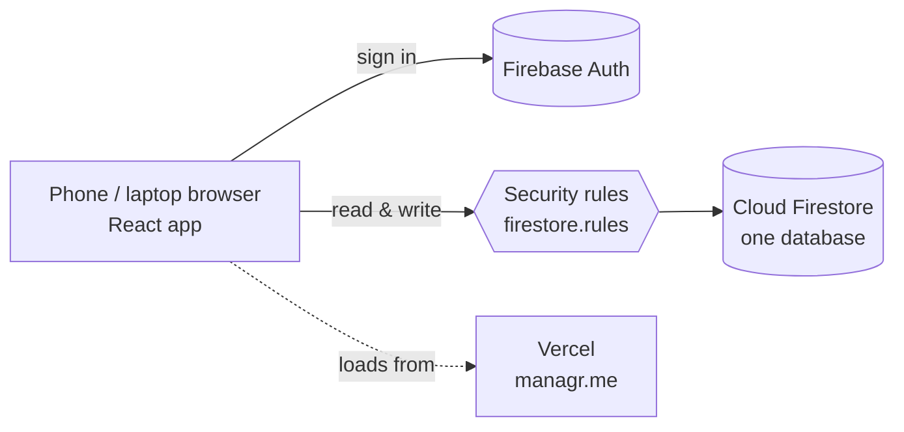

# Handover guide

Everything needed to run, explain, evaluate and maintain Digital Manager. Start here.

## 1. What is delivered

|                  |                                                                                             |
| ---------------- | ------------------------------------------------------------------------------------------- |
| Live app         | https://managr.me (website on Vercel; domain at Tasjeel.ae)                                 |
| Source code      | This GitHub repository (transferred to you at handover, see §8)                             |
| Database, logins | Firebase project `digital-manager-f916d` (free Spark plan, Firestore in Doha `me-central1`) |
| Documentation    | `docs/` (this guide, product, architecture, data model, deployment, build plan)             |

Modules: login with Owner / Manager / Employee roles · dashboard with "Needs your attention" · calendar · employees · attendance (phone clock-in) · shift rota and swaps · leave & pay, payslips (WPS tracking), end-of-service settlement · recruitment, probation, training & goals · tasks (Kanban) · checklists, handovers, incidents · food safety · equipment & maintenance · inventory, suppliers and purchase orders · sales & finance with VAT estimate · customer feedback · documents · rule-based notifications · performance scores · weekly / monthly reports with PDF and CSV export · several branches for owners · settings. Works on phone, tablet and desktop.

## 2. How it works (for the presentation)



- **One database, connected modules.** Every module stores its records in the same Firestore database, so one action updates everything that depends on it:

  ```
  Employee clocks in → attendance record (server time) → On Time / Late calculated
     → late-arrival notification + activity log → dashboard and performance score update

  Stock adjusted → new quantity → Low / Critical status → stock movement logged
     → manager notified only if it got worse → dashboard alert
  ```

- **Rule-based, no AI.** Lateness, stock status, overdue tasks and the performance score are small, tested functions in `packages/shared/src/rules/`. Example from the requirements: shift 07:00, clock-in 07:18 → **Late – 18 min**; oat milk 14 L with minimum 15 L → **Low**.
- **Performance score** = 30 % attendance + 25 % punctuality + 30 % tasks completed on time + 15 % manager rating (weights editable in Settings). Shown with its formula on every report.
- **Security.** The browser talks to the database directly, and `firestore.rules` decides every request on the server: employees see only their own data, the clock-in time must be the server's time (a phone can't fake it), statuses must match the rules, and deactivated staff are locked out. 43 automated tests prove these rules (`pnpm test:rules`).
- **Automatic checks without a server.** On the free plan there is no server code, so the time-based jobs (mark absences, overdue tasks, daily performance scores, weekly report) run in the manager's browser when the manager opens the app (and every 10 minutes while it's open). Screens also work out time-based states on their own, so they're always right when opened. Details: `docs/ARCHITECTURE.md`.

## 3. Demo script (≈ 10 minutes)

Use the live app with **Settings → Sample data → Load sample data** (remove it before real use), or run locally with the seeded café (§6).

1. **Manager login** → Dashboard: everything comes from the database (present / late / absent, tasks, low stock, performance, activity, notifications).
2. **Employees** → add an employee with a shift; open a profile (attendance history, tasks, notes / warnings / achievements).
3. **Phone view** (a real phone, so GPS and camera work) → log in as that employee → **Clock in**: allow location, take the photo. If the shift started earlier it shows _Late – N min_; the screen then counts _Working for_ and the time left. Tap **Clock out** early to see the _Leave before your shift ends?_ warning. (Set **Settings → Shop location** first, standing in the shop.)
4. Back as manager → the bell shows "_X arrived N minutes late_"; **Attendance** shows the record; correct it or mark Leave with the pencil.
5. **Tasks** → create a task for the employee → the employee gets a notification → employee taps **Start** then **Complete** → manager is notified "_X completed …_".
6. **Inventory** → Adjust stock → _Used 8 L_ of oat milk → status becomes Low / Critical → alert appears on the dashboard and bell.
7. **Performance Reports** → weekly / monthly, highlights, rate an employee (score changes by the formula), **Download PDF**, **Export CSV**.
8. **Leave & pay** → on an employee's profile set a salary (Pay & leave → Edit); as that employee request leave (**Leave** → Request leave); as manager approve it on **Leave & pay** and see the days on Attendance and the deduction in **Pay this month**.
9. **Documents** → upload a PDF or a phone photo of a license; the toast shows how much smaller it got; open it again. Give it an expiry date 2 weeks ahead: it shows **Expires in 14 days** and the bell gets a reminder.
10. **Payslips** → Leave & pay → Pay & payslips → Prepare for an employee, add a bonus, Save & mark paid, download the PDF; as that employee, Leave & pay → My payslips.
11. **Dashboard → Needs your attention** and **Calendar** → everything that needs action and who's off when.
12. **Rota** → change someone's day to Off; as that employee, clock-in says _You're off today on the rota_. As an employee open **My rota** → Swap → the manager approves on Rota and both days change.
13. **Shop checklists** (employee, phone) → tick the opening checklist; log a fridge at 8 °C → the manager's bell shows _Temperature out of range_.
14. **Purchasing** → New order for oat milk → Mark ordered → Receive → Inventory shows the new quantity; Mark paid with the invoice number.
15. **Sales & finance** → enter today's takings and an expense → profit and the VAT estimate update; the next VAT return date is shown.
16. **Employee profile → Final settlement** → gratuity, leave pay and last salary by UAE rules, as a PDF.
17. **Settings** → change the grace period or performance weights → show that the rules are configurable, not hard-coded.

## 4. Data for the Capstone evaluation

Every record is stored with timestamps (`createdAt`, `updatedAt`, clock-in/out, completion time), and every important action is written to the **activity log**.

**Performance Reports → Export CSV** downloads, for any week or month:

| File               | Use it for                                                                                 |
| ------------------ | ------------------------------------------------------------------------------------------ |
| Attendance records | attendance accuracy, lateness, absences (each record shows whether a manager corrected it) |
| Tasks              | task completion rate, on-time completion (`completed_on_time` column)                      |
| Stock movements    | inventory monitoring (every change with reason and who made it)                            |
| Activity log       | how the system was used, by whom and when (usability, report preparation)                  |

The PDF report covers the same period for managers.

## 5. Making basic changes

| Change                                                                                                                                            | Where                                                                                                 |
| ------------------------------------------------------------------------------------------------------------------------------------------------- | ----------------------------------------------------------------------------------------------------- |
| Grace period, absence threshold, critical stock %, performance weights, task categories, notification on/off, opening hours, shifts, shop details | **In the app: Settings** (no code)                                                                    |
| Wording on a screen                                                                                                                               | `apps/web/src/features/<module>/pages/…Page.tsx`                                                      |
| Colours / theme                                                                                                                                   | `apps/web/src/index.css` (CSS variables at the top)                                                   |
| A business rule (e.g. how lateness is calculated)                                                                                                 | `packages/shared/src/rules/*.ts`, then update its test in `rules.test.ts`                             |
| Who may read / write what                                                                                                                         | `firestore.rules`, add a case to `tools/rules.test.ts`, deploy rules (§7)                             |
| A new screen                                                                                                                                      | add a page under `apps/web/src/features/<module>/pages/` and a route in `apps/web/src/app/router.tsx` |

After a code change: `pnpm check` (must pass), then deploy (§7). `CLAUDE.md` and `.claude/rules/` describe the code conventions.

## 6. Run it locally

```bash
pnpm install
cp apps/web/.env.example apps/web/.env.local
pnpm emulators     # terminal 1 (needs Java 21)
pnpm seed          # once: sample coffee shop
pnpm dev           # terminal 2 → http://localhost:5173
```

Sample logins (local only): `hana@dm.cafe` (manager), `ahmed@dm.cafe` (employee), password `password123`.

Tests:

```bash
pnpm check        # format, lint, types, 41 business-rule unit tests
pnpm test:rules   # 33 security-rule tests   (emulators running)
pnpm test:flows   # 9 end-to-end flows       (emulators running)
```

## 7. Deploy an update

```bash
npx firebase login
npx firebase deploy --project prod --only firestore   # rules + indexes, only after changing them (deploy these first)
pnpm indexes:wait                                     # wait until new indexes are built before using the app
git push origin main                                  # the website: Vercel builds and deploys every push to main
```

Pushing to `main` is a production deploy. Details: `docs/DEPLOYMENT.md` → _Website: Vercel + managr.me_.

Add a row to the deploy log in `docs/DEPLOYMENT.md`.

## 8. Handing over the accounts

1. **Firebase:** console → Project settings → _Users and permissions_ → add the client's Google account as **Owner**. After they accept, remove the developer account. (Free plan: no billing to move.)
2. **GitHub:** repo _Settings → Danger zone → Transfer ownership_ to the client's account.
3. **First manager account** (if not done yet): see `docs/DEPLOYMENT.md` → _First manager account_.
4. The client creates `apps/web/.env.production.local` on their computer (values in `docs/DEPLOYMENT.md`) before deploying.
5. **Vercel:** project `digital-manager` → Settings → _Transfer project_ to the client's Vercel account; reconnect the GitHub repo after its transfer.
6. **Domain:** `managr.me` is in the client's Tasjeel.ae account; renew it every year.

## 9. Known limits (worth stating in the presentation)

- **Automatic checks need a manager to open the app.** Nothing is written while nobody has it open; screens still show the right state when opened. On the paid Blaze plan the same functions could run on a schedule.
- **Timezone in the rules.** The security rules check that the clock-in uses the employee's real shift and a sensible time window; they can't recompute the exact shift-start moment because rules can't convert timezones.
- **Location and photo are evidence, not proof.** A determined person can fake GPS on a phone, and the photo is checked by eye (no face recognition). Both are recorded only at clock-in / clock-out; a website can't track someone during the shift. Tell staff their location and photo are recorded (the clock-in screen says so) — the UAE data-protection law expects it.
- **Not included in v1:** fingerprint devices (attendance records already have a `source` field for it), push notifications to phones, multi-branch screens, payroll / POS.
