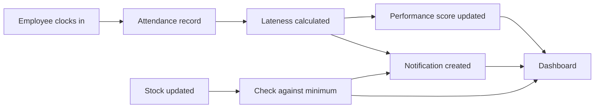

# Digital Manager – Product Scope & Estimate

Sep 24, 2026

## Overview

We will turn the existing Lovable prototype into a working web app and iPhone app, with one shared database, login, automatic calculations, notifications and reports. We estimate **12–14 weeks for two developers** and **about 80–100 person-days** of work, including the iPhone app.

- **What it is:** a management system for one coffee shop that can grow to more branches later.
- **Users:** a Manager/Owner with full access and Employees with limited access. Employees mostly use their phones.
- **What exists today:** a UI prototype built in Lovable. We keep this design and connect it to real data. We do not redesign it.
- **Purpose:** a Capstone 2 project. The system must store timestamped records so the student can measure results during testing.

## What we're building

A web app where a coffee shop manager runs staff, tasks and stock in one place. The system does the checks and calculations itself.

**The manager (desktop):**

- Adds employees and assigns their shifts.
- Creates tasks, assigns them, and follows them on a Kanban board.
- Adds stock items and updates quantities.
- Sees a live dashboard: who is here, who is late or absent, open tasks, low stock and alerts.
- Views performance scores and weekly or monthly reports, and downloads them as PDF.

**The employee (mostly on a phone):**

- Logs in, then clocks in and out.
- Sees their shifts, tasks and attendance, and marks tasks done.

**What the system does automatically:**

| When this happens                          | The system does this                                                        |
| ------------------------------------------ | --------------------------------------------------------------------------- |
| Shift starts 7:00, employee clocks in 7:18 | Marks "Late – 18 min", lowers their score, notifies the manager             |
| Employee never clocks in                   | Marks Absent                                                                |
| A task's deadline passes and it isn't done | Moves it to Overdue and notifies the manager                                |
| Oat milk drops to 14 L (minimum 15 L)      | Marks it Low (or Critical), shows it on the dashboard, notifies the manager |
| The week ends                              | Builds the weekly report and sends a "report ready" alert                   |

## Prototype review

The prototype has 9 manager screens, but nothing in them works: all data is hard-coded and the buttons do nothing. We reviewed it on Sep 25, 2026 using the shared preview link.

| Screen              | What the prototype shows                                                             |
| ------------------- | ------------------------------------------------------------------------------------ |
| Login               | Email and password form (demo only). No separate employee login                      |
| Dashboard           | 8 stat cards, 3 charts, stock alerts, upcoming tasks, recent activity, notifications |
| Employees           | Table of staff with role, shift, status, performance and attendance                  |
| Attendance          | Today's clock-ins with minutes late, 7-day chart, monthly calendar                   |
| Tasks               | Kanban (Pending / In Progress / Completed / Overdue) and a list view                 |
| Inventory           | Low and critical alerts, and a table of items with suppliers                         |
| Performance Reports | Weekly and monthly views, top and lowest performers, employee report card            |
| Notifications       | Alert list: late arrival, task done, low stock, report ready                         |
| Settings            | 8 setting cards and a list of branches                                               |

**Missing, so we must design and build it (about 10–12 screens):**

- The whole employee side: clock in and out, my tasks, my attendance (phone-first).
- Employee profile page.
- Add and edit forms for employees, tasks and stock items.
- The 8 settings pages (only the cards exist).
- A suppliers page.

**In the prototype but not in the requirements:**

- "Revenue Today" and POS sync: we propose removing it.
- 3 branches: we build for one shop, ready for more later.
- Email and SMS alerts: version 1 uses in-app and phone push alerts only.
- Dark mode, global search and a "Create order" button: kept only if the student wants them.

## Tech stack and connecting the prototype

We use one language, **TypeScript**, for both the front end and the back end. There is no separate server to build or host: Firebase handles login, the database and hosting, and the rules run in the app, guarded by Firestore security rules. Since 2026-10-07 the project runs on Firebase's free Spark plan (no Cloud Functions); see `docs/ARCHITECTURE.md`.

| Part                            | Technology                                                                      | Language   |
| ------------------------------- | ------------------------------------------------------------------------------- | ---------- |
| Front end (web)                 | React + Vite, Tailwind CSS, shadcn/ui (what Lovable already uses)               | TypeScript |
| Forms and charts                | React Hook Form + Zod, Recharts                                                 | TypeScript |
| Back end (rules and automation) | Shared rules run in the app + Firestore security rules (free Spark plan)        | TypeScript |
| Database                        | Cloud Firestore                                                                 | —          |
| Login and roles                 | Firebase Authentication                                                         | —          |
| Web hosting                     | Firebase Hosting                                                                | —          |
| PDF reports                     | jsPDF (in the browser)                                                          | TypeScript |
| iPhone app                      | Capacitor (wraps the same React app) + Firebase Cloud Messaging for push alerts | TypeScript |

**What we reuse and what we build:**

| Part                                                                 | Reuse or build           |
| -------------------------------------------------------------------- | ------------------------ |
| Layouts, styling and components of the 9 existing screens            | Reuse the Lovable code   |
| Missing screens (employee side, forms, profile, settings, suppliers) | Build, in the same style |
| Login, database, rules, notifications, reports, PDF, iPhone app      | Build from scratch       |

Reusing the screens saves about 15–20% of the work. The main work (data, logic, back end) is new.

**How we connect the prototype:** the student links the Lovable project to a GitHub repo on the student's own account. We clone it and replace the hard-coded data with live Firebase data, one screen at a time. If the code can't be exported or is too messy, we rebuild the screens from the design, which adds about 1–2 weeks.

**iPhone app:** the same React code runs inside Capacitor as a native iPhone app. We don't write a second app in Swift. We add push notifications and a phone-friendly layout so Apple accepts it, then publish through TestFlight or the App Store. An Android app can come from the same code later.

**Why not a custom server (Node.js + Express + PostgreSQL)?** It works, but it adds about 2–3 weeks, a monthly server cost, and more for the student to run and explain.

Every action saves a record, and the same save updates the other modules automatically. Nothing on the dashboard is entered by hand.

## Scope

Version 1 is a web app plus an iPhone app, on one shared database. Effort includes the screens the prototype is missing.

| Module                | What's included                                                                                                          | Effort (person-days) |
| --------------------- | ------------------------------------------------------------------------------------------------------------------------ | -------------------- |
| Setup & login         | Repo, Firebase on the student's accounts, Manager/Employee roles, protected pages, security rules                        | 6–8                  |
| Employees             | Add, edit and deactivate staff; roles and shifts; new profile page (history, warnings, achievements, notes)              | 9–11                 |
| Attendance            | Manager view, plus new employee clock-in and clock-out screen; automatic On Time / Late (minutes) / Absent / Leave / Off | 9–11                 |
| Tasks                 | Kanban and list, new create and edit forms, employee "my tasks", automatic Overdue                                       | 7–9                  |
| Inventory & suppliers | Items, stock updates, OK / Low / Critical status, new suppliers page and forms                                           | 6–8                  |
| Notifications         | In-app alerts created by rules (late arrival, task done, low stock, overdue task, report ready)                          | 5–6                  |
| Performance           | Score out of 100 from attendance, punctuality, tasks and manager rating; compare employees                               | 4–6                  |
| Dashboard             | Live overview built from data in the database                                                                            | 3–5                  |
| Reports               | Weekly or monthly report for a chosen period, with PDF export                                                            | 5–7                  |
| Settings              | 8 new settings pages (the prototype only has the cards)                                                                  | 6–8                  |
| Testing & handover    | Mobile layout, test data, bug fixes, deployment, documentation                                                           | 8–10                 |
| iPhone app            | Capacitor setup, push notifications, icons, TestFlight / App Store submission and review fixes                           | 8–12                 |
| **Total**             |                                                                                                                          | **~80–100**          |

The performance score is a simple weighted formula. The manager can change the weights in Settings. A starting example:

> **Score = 0.30 × Attendance + 0.25 × Punctuality + 0.30 × Task completion + 0.15 × Manager rating**

**Not in version 1 (possible later):**

- Fingerprint scanner. Clock-ins are saved through one function, so a scanner can use the same path later.
- Screens for managing several branches. Every record includes a `branchId` from the start, so adding branches later needs no database changes.
- Android app (same code, about 1 week more), email and SMS alerts.
- Revenue / POS sync, payroll and AI-generated suggestions.

## Timeline (2 developers)

The work takes about 13 weeks, plus 1 week of buffer for review feedback and Apple review. Developer A builds the screens (front end and iPhone app). Developer B builds the database, rules and automation (back end). The student approves each stage before the next one starts.

| Stage             | Weeks | Delivers                                                                                    | Student reviews                                  |
| ----------------- | ----- | ------------------------------------------------------------------------------------------- | ------------------------------------------------ |
| 1. Foundation     | 1     | Repo and Firebase on the student's accounts, login, roles, prototype connected              | Can log in as Manager or Employee                |
| 2. People         | 2–3   | Employees, profiles, forms, shifts, Settings pages                                          | Add staff and assign shifts                      |
| 3. Operations     | 3–6   | Attendance with lateness logic, employee phone screens, Kanban tasks with automatic Overdue | Clock in late on a phone and see "Late – 18 min" |
| 4. Stock & alerts | 6–8   | Inventory, suppliers, notification rules                                                    | Lower stock and get a Low alert                  |
| 5. Insights       | 8–10  | Performance scores, live dashboard, reports and PDF                                         | Weekly report downloads as a PDF                 |
| 6. Web launch     | 10–11 | Testing, deployment, docs                                                                   | Live web URL                                     |
| 7. iPhone app     | 12–13 | Capacitor build, push alerts, TestFlight / App Store submission, handover                   | App installed on staff iPhones                   |

Submit to Apple at least 2 weeks before the Capstone deadline. Review usually takes 1–3 days, and a rejection adds more. One developer alone would need about 20–24 weeks.

## Cost

Building the web and iPhone app takes about 640–800 hours (80–100 days × 8 hours). The price depends mostly on the hourly rate. Running it for one coffee shop costs about ₹9,000 a year, mostly Apple's developer fee.

**Build cost (one time)**

| Who builds it                         | Typical rate  | Estimated total               |
| ------------------------------------- | ------------- | ----------------------------- |
| Freelancers in India                  | ₹500–800 / hr | ₹3.2–6.4 lakh (~$3,500–7,000) |
| Small agency (India / Eastern Europe) | $25–40 / hr   | $16,000–32,000                |
| US / UK agency                        | $80–150 / hr  | $50,000+                      |

The iPhone app is about ₹40–75k of this total. Without it: ₹2.8–5.8 lakh.

We suggest a fixed price split into payments, one when each stage is approved. For example: 20% at the start, then 15% each for stages 2–5, and 20% at handover.

**Running cost (paid by the student, on the student's own accounts)**

| Item                                                                                | Cost                                   |
| ----------------------------------------------------------------------------------- | -------------------------------------- |
| Apple Developer Program (needed for TestFlight and the App Store)                   | $99 / year (about ₹8,500–9,500)        |
| Firebase Spark plan (free; no card needed). Free usage limits easily cover one shop | $0                                     |
| Firebase Hosting and push notifications                                             | Free at this size                      |
| Google Play (only if Android is added)                                              | $25 once (about ₹2,400)                |
| Custom domain (optional)                                                            | ~$10–15 / year                         |
| Lovable                                                                             | Not needed once the code is in GitHub  |
| Fingerprint scanner (future)                                                        | ~$80–200 per device + integration work |
| Mac with Xcode (to build the iPhone app)                                            | Uses a developer's existing Mac        |

These figures are approximate and based on typical rates and Firebase's published free limits. Push notifications for the iPhone app would need the Blaze plan (card on file, ~$0–5 / month).

## Ownership and handover

The student owns every account from day one. The developers are only invited as collaborators and are removed at handover.

- **GitHub:** the repo is on the student's account. Developers are added as collaborators.
- **Firebase / Google Cloud:** the student creates the project and adds the developers as Editors. The billing card is the student's.
- **Domain (if used):** registered in the student's name.
- **At handover:** developer access is removed and the student's admin account is confirmed working.

**Documents delivered with the code:**

1. README: how to install, run locally and deploy.
2. Architecture guide: a diagram of how the modules connect, for the presentation.
3. Database guide: every collection, its fields, and how they link.
4. Rules guide: the lateness, stock, overdue and performance formulas, and where to change them.
5. "How to make basic changes": adding a field, a notification rule or a new screen.
6. A 1–2 hour recorded walkthrough of the code.

## Open questions for the client

- [ ] What is the budget, and when is the Capstone 2 deadline?
- [ ] Can you connect the Lovable project to a GitHub repo on your account and add us? We have only seen the preview, not the code.
- [ ] Does your university allow outside developers on a Capstone, and does it need to be disclosed?
- [ ] Public App Store listing, or TestFlight only for your staff? Both need the $99 Apple account in your name.
- [ ] Remove the Revenue / POS card, and build for one branch first?
- [ ] Should we stop employees clocking in from home (for example a QR code at the shop or a location check)?
- [ ] When does a no-show count as Absent (for example 60 minutes after the shift starts)?
- [ ] What counts as Critical stock (for example below 50% of the minimum)?
- [ ] Is the app English only, or does it need another language (for example Arabic, right-to-left)?
